<p align="center">
  
</p>

<p align="center">
  <strong>WebSSH 3 — your self-hosted SSH, files and automation workspace.</strong>
</p>

<p align="center">
  <a href="https://getwebssh.com/">Product site</a> ·
  <a href="site/demo.html">Watch the full tour</a> ·
  <a href="https://github.com/bifrost0x/webssh/wiki">Documentation</a> ·
  <a href="ROADMAP.md">Roadmap</a> ·
  <a href="https://github.com/bifrost0x/webssh/pkgs/container/webssh">Container image</a> ·
  <a href="https://github.com/bifrost0x/webssh/discussions">Discussions</a>
</p>

<p align="center">
  <a href="https://github.com/bifrost0x/webssh/actions/workflows/tests.yml"></a>
  <a href="https://github.com/bifrost0x/webssh/actions/workflows/github-code-scanning/codeql"></a>
  <a href="https://github.com/bifrost0x/webssh/pkgs/container/webssh"></a>
  
  <a href="LICENSE"></a>
  <a href="https://getwebssh.com/code-graph/"></a>
  <a href="https://github.com/bifrost0x/webssh/releases"></a>
  <a href="https://github.com/bifrost0x/webssh/stargazers"></a>
  
</p>

## Product tour

<p align="center">
  <a href="site/demo.html">
    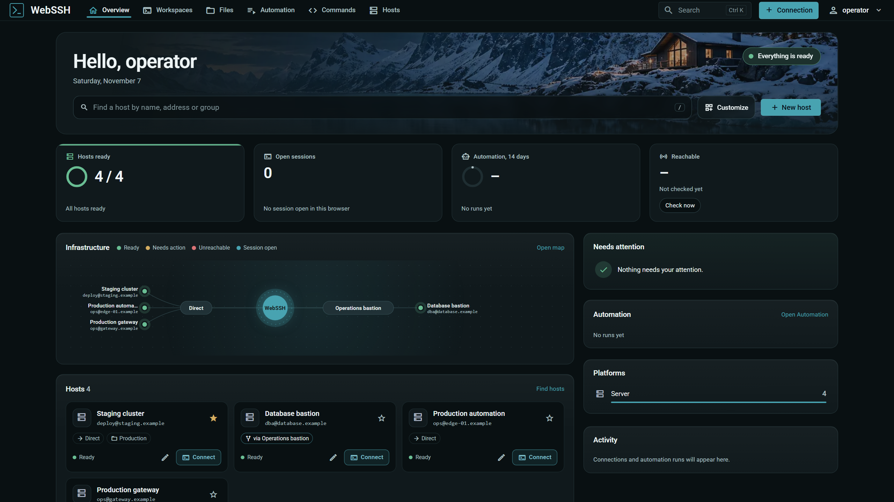
  </a>
</p>

WebSSH keeps terminal work, files, commands, diagnostics, and notes in one
responsive browser workspace. It is self-hosted, multi-user, and built without
a hosted control plane or runtime CDN dependencies.

<details>
  <summary>Preview the animated product tour</summary>

  <p align="center">
    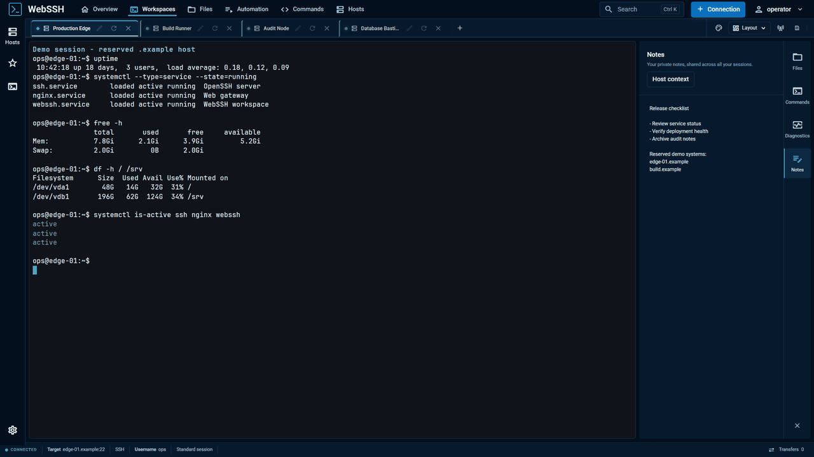
  </p>
</details>

## New in WebSSH 3

<table>
  <tr>
    <td width="33%" valign="top">
      <h3>Status-first overview</h3>
      Host readiness, open sessions, automation results and reachability at a
      glance. Arrange panels freely, dismiss handled alerts and find hosts with
      <kbd>/</kbd>.
    </td>
    <td width="33%" valign="top">
      <h3>Native automation</h3>
      Run command sets and templates now or on a schedule, with exact-target
      review, saved passwords or keys and bounded per-step output.
    </td>
    <td width="33%" valign="top">
      <h3>Find SSH hosts</h3>
      Scan a network range you choose for SSH and SFTP servers, gently and only
      on request, then add a host from a prefilled form.
    </td>
  </tr>
</table>

Upgrading from 2.x? Read the [WebSSH 3 changes and upgrade notes](docs/webssh-3.md).

## Why WebSSH

- **One workspace, not a terminal tab.** Keep SSH sessions, SFTP sources,
  commands, live Linux context, and notes aligned with the active server.
- **Self-hosted by design.** Accounts, profiles, encrypted keys, host trust,
  audit records, and application data remain on your WebSSH instance.
- **Safe operational boundaries.** Authentication, ownership checks, network
  policy, host-key verification, quotas, and bounded runtime work are explicit.
- **Useful from phone to workstation.** The same interface adapts from a focused
  mobile shell to multi-pane desktop operations.

## Features

### Overview and automation

- Status-first overview: host readiness from stored configuration, open
  sessions, 14-day automation results, reachability and recent activity.
- Free layout per account: drag, resize, hide and restore panels, with keyboard
  controls and a reset to the default arrangement.
- **Needs attention** lists unverified host keys, missing jump hosts, changed
  saved passwords and failed runs. Handled items can be dismissed and come back
  when the situation changes.
- Optional reachability checks (off, on demand, or automatic): one TCP
  connection to the SSH port under the SSH network policy, no login.
- Hosts show their platform and services such as Docker or Nextcloud, read-only
  over SSH without elevated rights.
- **Find hosts** scans a range you name for SSH and SFTP servers at a gentle,
  fixed pace and opens the host form prefilled. It only runs when you start it.
- Readable route summaries and an expandable SSH map with saved arrangements.
- A classic overview remains available, with a per-account choice of Overview
  or Workspaces as the start page after sign-in.
- Reusable workflows from commands, command sets and templates, immediate runs,
  cron schedules, cancellation and bounded per-step output history, for saved
  hosts or complete groups. Administrators enable Automation; it is disabled by
  default and requires HTTPS.
- Optional encrypted, per-account passwords shared by saved hosts and supported
  connection types. Administrators enable this under Integrations.
- Application backup exports exclude stored passwords and SSH private keys.
  Keep a separate credential recovery plan before restoring.

See the [WebSSH 3 changes and upgrade notes](docs/webssh-3.md),
[automation guide](docs/automation.md) and [credential guide](docs/credentials.md).

<details>
  <summary>See all eleven themes in WebSSH 3</summary>

  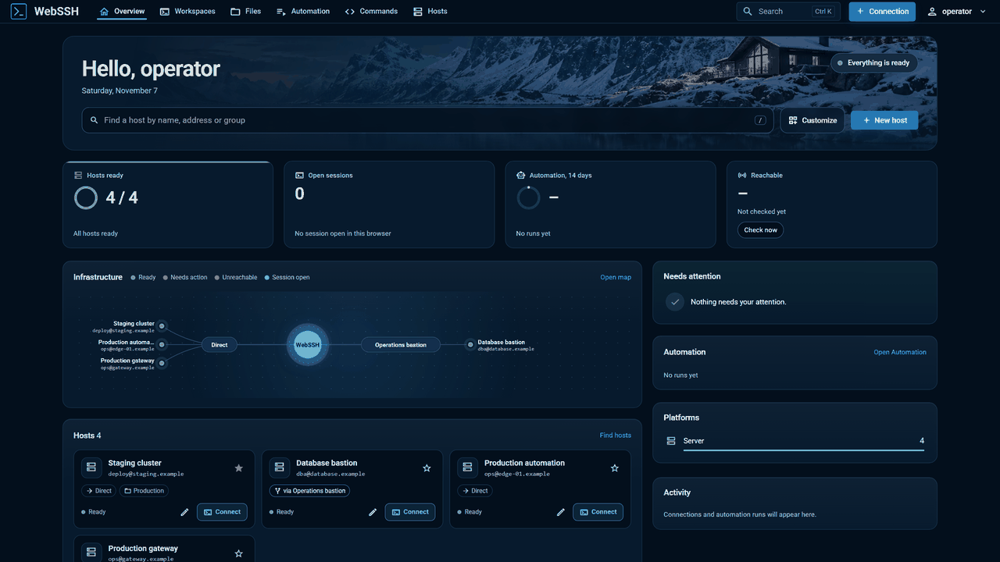
</details>

### Terminal workspace

- Multiple SSH sessions with tabs and 1-, 2-, or 4-pane layouts.
- Optional persistent remote shells through tmux, with session-local mouse
  scrolling and folder synchronization after explicit Bash prompt setup.
- Saved connections, jump hosts, key, password, SSH server PAM MFA, and
  optional Tailscale SSH authentication paths.
- Broadcast input, terminal search, transcripts, reconnect controls, and
  configurable scrollback.
- Per-account terminal appearance with four self-hosted Nerd Font Mono families
  (JetBrains Mono, Hack, Fira Mono, and Source Code Pro), local font selection,
  and live shell, code, and character previews.
- Session-aware Files, Commands, Diagnostics, and Notes contexts.
- **Active Session Monitoring** for supported Linux resource and runtime data.
- **Expanded Diagnostics** for resource history, processes, systemd services,
  and Docker containers.
- **Clipboard-Only Service Actions** that prepare allowlisted commands without
  executing the service change inside WebSSH.

Fonts and Nerd Font symbols are served locally; see the
[terminal font guide](static/vendor/terminal-fonts/README.md).

### Files and transfers

- Source-first SFTP and opt-in SMB workspace with independent tabs and one or
  two file panes.
- Uploads, downloads, previews, inline text editing, and common file operations.
- Streamed HTTP bulk transfers with Socket.IO limited to control events and
  bounded editor content.
- Server-to-server transfers across SFTP and SMB sources with progress,
  cancellation, explicit conflict handling, and a shared transfer queue.
- Same-source moves between folders without silently replacing existing items.
- Stable, visible transfer reasons such as permission denied, conflict,
  unavailable source, timeout, and configured-limit violations.
- Per-user ownership checks, size limits, quotas, and path validation.

SMB is disabled by default (`SMB_ENABLED=false`) and needs an exact
`SMB_ALLOWED_TARGETS` allowlist. WebSSH requires SMB 3.1.1 with signing and
encryption, never silently overwrites a destination and refuses symlink and
wide-link traversal. See the
[file workspace guide](https://github.com/bifrost0x/webssh/wiki/SFTP-File-Workspace-and-Transfers)
for authentication, access checks, limits and the trust boundary.

### Identity and security

- Local multi-user accounts with isolated profiles, keys, files, settings, and
  SSH host trust.
- Optional Passkeys, authenticator apps (TOTP), and one-time Recovery Codes.
- Optional OIDC, admin-configured GitHub App, and LDAP/Active Directory sign-in with conservative account
  linking and assurance handling.
- Action-bound confirmation for protected account and administrative changes.
- Encrypted SSH private-key storage and per-user known-host decisions.
- CSRF protection, secure response headers, rate limits, request limits, audit
  logging, and production fail-closed checks.

### Operations and administration

- Docker and Docker Compose deployment with a persistent data volume.
- Health and readiness endpoints for deployment checks.
- User administration, registration controls, security feature gates, and
  structured audit export and retention.
- Consistent online backups and restore with maintenance mode, staging
  isolation, quotas, explicit confirmation, and bounded execution.
- Optional Redis-backed rate-limit counters.
- Vendored browser dependencies, a same-origin Content Security Policy, and no
  built-in telemetry.

## Screenshots

Captured from the current interface with synthetic hosts and example data.

### Arrange the overview

<p align="center">
  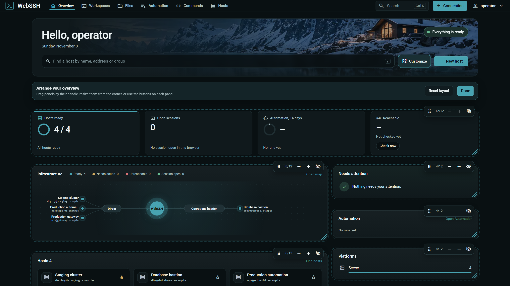
</p>

Every panel can be moved, resized or hidden. The arrangement belongs to your
account and stacks in the same order on small screens.

### Find SSH hosts

<p align="center">
  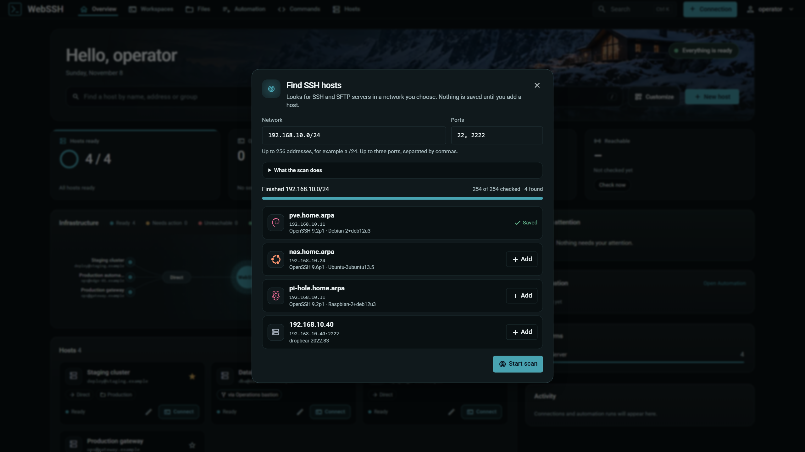
</p>

Discovery reads only the greeting an SSH server sends by itself, marks hosts
you already saved and turns a result into a prefilled new host.

### Focused session workspace

<p align="center">
  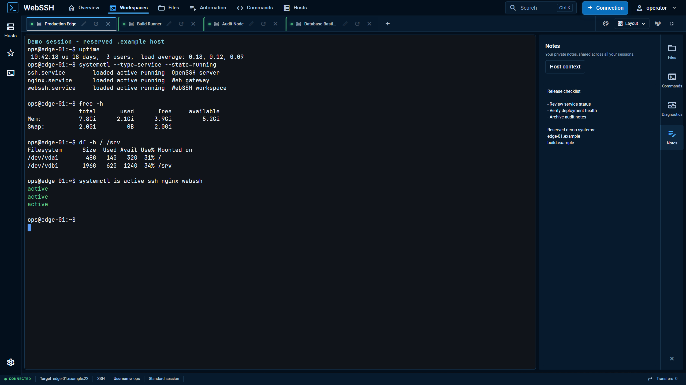
</p>

The active session stays central while contextual tools remain close at hand.

### Multiple live sessions

<p align="center">
  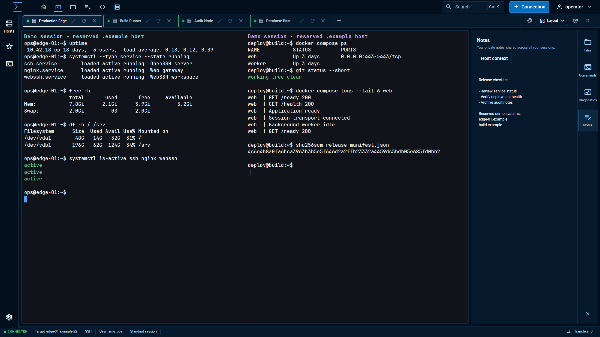
</p>

Split panes make side-by-side observation and coordinated work visible without
mixing session ownership or terminal state.

### Commands, favorites, and reusable sequences

<p align="center">
  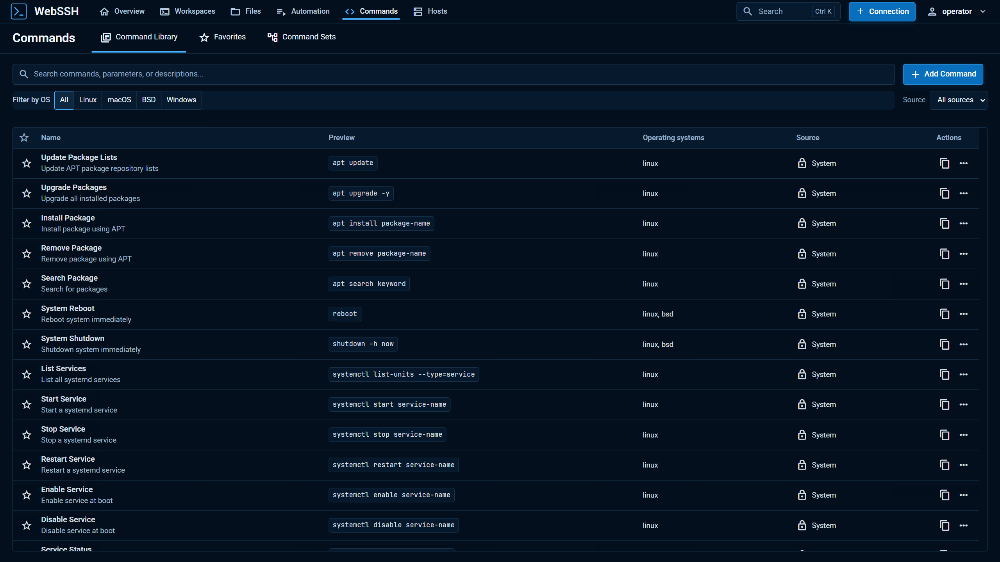
</p>

Browse the library, keep frequently used entries in Favorites, and build
reusable Command Sets. Each has its own label, icon, and color.

<p align="center">
  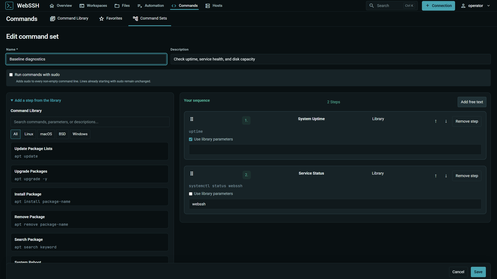
</p>

Arrange steps, review parameters, and assign a saved sequence to a connection.

### File workspace

<p align="center">
  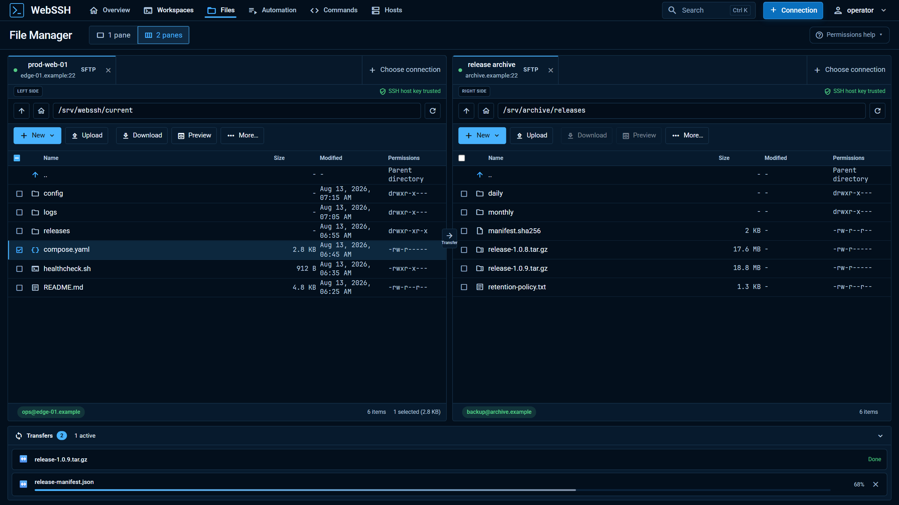
</p>

Each pane has an explicit source, endpoint, path, trust state, and selection.

Optional SFTP Unix permissions (disabled by default) preview changes before
applying them; see the [permissions guide](https://github.com/bifrost0x/webssh/wiki/SFTP-File-Workspace-and-Transfers#unix-permissions).

### Review file changes before saving

<p align="center">
  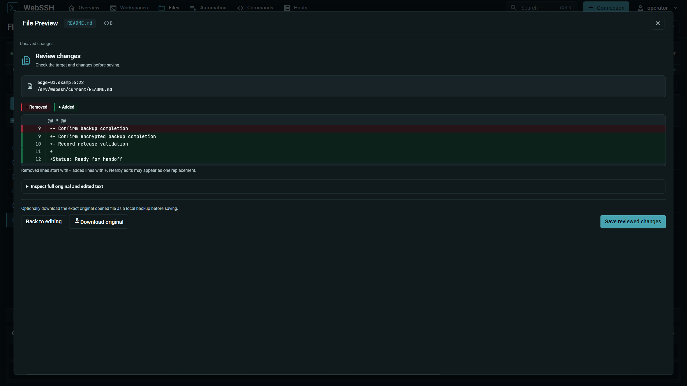
</p>

Check the target and changed lines, optionally download the original, then
explicitly save the reviewed content.

<details>
  <summary>Preview the file editing workflow</summary>

<p align="center">
  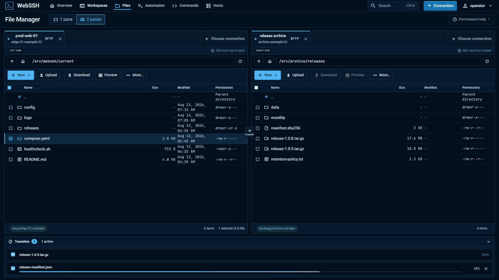
</p>

</details>

### Security Center

<p align="center">
  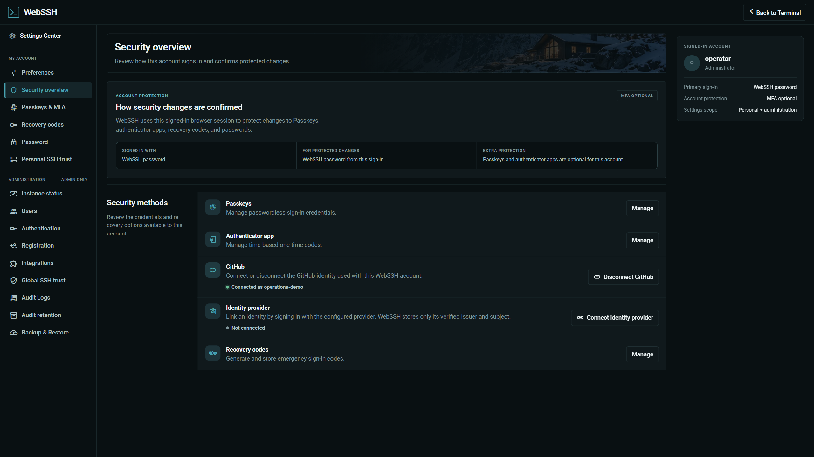
</p>

The Security Center explains how the current sign-in confirms protected
changes and keeps factors and SSH trust in one account-owned view.

### Mobile workspace

<p align="center">
  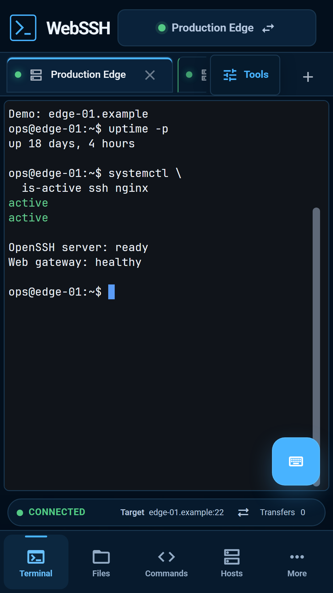
</p>

## Quick Start

The supplied Compose file is intended for evaluation and trusted homelab
networks. It stores the database, generated application secret, user data, and
encrypted keys in the `webssh_data` volume.

```bash
mkdir webssh-deployment
cd webssh-deployment
curl -O https://raw.githubusercontent.com/bifrost0x/webssh/main/docker-compose.yml
docker compose up -d
```

Open <http://localhost:5000>. On a new instance, create the first administrator
immediately from a trusted network. The one-time browser bootstrap closes after
that account exists.

Verify readiness with `curl -fsS http://localhost:5000/ready`.

The supplied Compose file follows `latest`. For controlled upgrades, pin a
published version or verified image digest, keep Compose files from the same
release, and back up the data with matching secrets. See
[upgrade and rollback guidance](https://github.com/bifrost0x/webssh/wiki/Upgrading-Rollback-and-FAQ).

Do not expose this homelab configuration to the Internet unchanged. Read the
[Quick Start](https://github.com/bifrost0x/webssh/wiki/Quick-Start), the
[Production Deployment](https://github.com/bifrost0x/webssh/wiki/Production-Deployment)
guide and the [production container boundaries](docs/production-container.md).

## Security Boundary

<p align="center">
  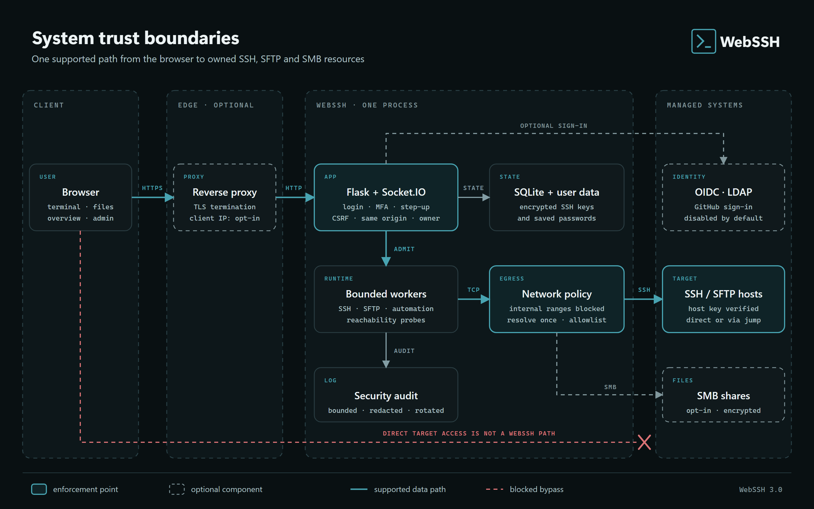
</p>

WebSSH is trusted infrastructure: it handles credentials, terminal I/O and file
data, and is not an end-to-end encrypted relay.

Keep these deployment contracts intact:

- Terminate HTTPS at a trusted boundary and protect the WebSSH host, data
  volume, logs, backups, and administrator accounts.
- Review SSH host-key fingerprints before trusting them and investigate
  unexpected changes.
- Production uses exactly **one Gunicorn `gthread` worker**. Live SSH state and
  part of the resource coordination are process-local; multiple workers or
  replicas are not supported without an external session-state architecture.
- Thread count, socket admission, per-user socket limits, background workers,
  and quotas form one capacity model. Keep HTTP capacity reserved.
- External OIDC or LDAP identity never bypasses the local account, ownership,
  or authorization model. Retain a tested local break-glass administrator.
- Native backups exclude saved remote passwords and SSH keys. They still contain
  account authentication data and may contain the persisted application secret;
  store them encrypted and off-host. After restore, reimport keys, recreate
  passwords, reassign credentials, and review and re-enable schedules.

See the [Security Model and Hardening](https://github.com/bifrost0x/webssh/wiki/Security-Model-and-Hardening)
guide and the project's [security policy](SECURITY.md) before exposing WebSSH
to untrusted networks.

## Documentation

Detailed guidance lives in the [WebSSH Wiki](https://github.com/bifrost0x/webssh/wiki);
its [versioned source](docs/wiki/Home.md) is reviewed with the code.

| Goal | Guide |
|---|---|
| Install with Docker | [Docker and Docker Compose](https://github.com/bifrost0x/webssh/wiki/Docker-and-Docker-Compose) |
| Deploy behind HTTPS | [Production Deployment](https://github.com/bifrost0x/webssh/wiki/Production-Deployment) |
| Configure every setting | [Configuration Reference](https://github.com/bifrost0x/webssh/wiki/Configuration-Reference) |
| Connect and verify hosts | [SSH Connections and Host Keys](https://github.com/bifrost0x/webssh/wiki/SSH-Connections-and-Host-Keys) |
| Use terminal and tmux sessions | [Terminal and Persistent tmux Sessions](https://github.com/bifrost0x/webssh/wiki/Terminal-and-Persistent-tmux-Sessions) |
| Work with files and transfers | [SFTP File Workspace and Transfers](https://github.com/bifrost0x/webssh/wiki/SFTP-File-Workspace-and-Transfers) |
| Configure authentication | [Authentication Overview](https://github.com/bifrost0x/webssh/wiki/Authentication-Overview) |
| Run backup or restore | [Backup, Restore and Secret Rotation](https://github.com/bifrost0x/webssh/wiki/Backup-Restore-and-Secret-Rotation) |
| Troubleshoot health checks | [Health Checks and Troubleshooting](https://github.com/bifrost0x/webssh/wiki/Health-Checks-and-Troubleshooting) |
| Understand the runtime | [Architecture and Runtime Lifecycle](https://github.com/bifrost0x/webssh/wiki/Architecture-and-Runtime-Lifecycle) |
| Develop and test locally | [Development and Testing](https://github.com/bifrost0x/webssh/wiki/Development-and-Testing) |

More: [roadmap](ROADMAP.md) · [project history](docs/project-history.md) ·
[planning and releases](docs/project-planning.md) · [product site](https://getwebssh.com/) ·
[code graph](https://getwebssh.com/code-graph/) · [container image](https://github.com/bifrost0x/webssh/pkgs/container/webssh)

## Contributing and Support

Bug reports and focused pull requests are welcome. For feature proposals and
architecture ideas, start with [GitHub Discussions](https://github.com/bifrost0x/webssh/discussions)
so the security and runtime boundaries can be reviewed before implementation.

- Read [Development and Testing](https://github.com/bifrost0x/webssh/wiki/Development-and-Testing).
- Use [Issues](https://github.com/bifrost0x/webssh/issues) for reproducible bugs.
- Report vulnerabilities privately through
  [GitHub Security Advisories](https://github.com/bifrost0x/webssh/security/advisories/new).
- Support ongoing work through [Buy Me a Coffee](https://buymeacoffee.com/bifrost0x).

## Star History

<p align="center">
  <a href="https://www.star-history.com/#bifrost0x/webssh&Date">
    <picture>
      <source media="(prefers-color-scheme: dark)" srcset="https://api.star-history.com/svg?repos=bifrost0x/webssh&type=Date&theme=dark">
      
    </picture>
  </a>
</p>

## License

WebSSH is available under the [Apache License 2.0](LICENSE).

Bundled third-party components retain their own licenses. See
[Licensing](docs/licensing.md) and [retained notices](THIRD-PARTY-NOTICES).
