# WebSSH screenshots

[Back to the project overview](../README.md).

Captured from the current interface with synthetic hosts and example data.

### Focused session workspace

  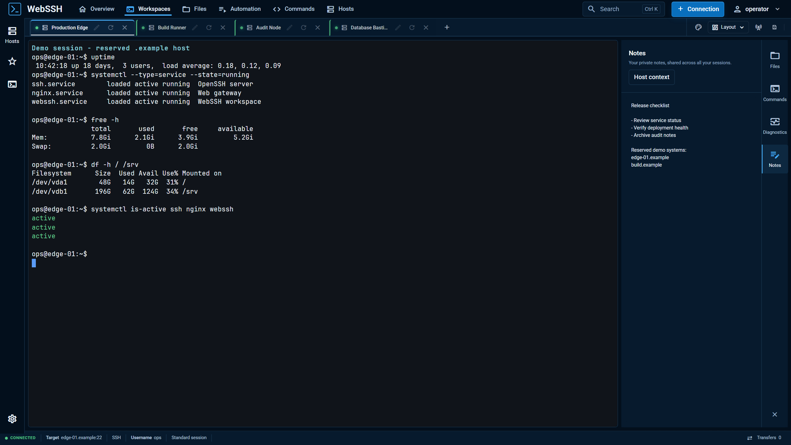

The active session stays central while contextual tools remain close at hand.

### Multiple live sessions

  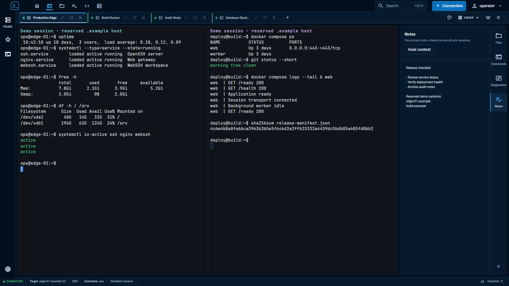

Split panes make side-by-side observation and coordinated work visible without
mixing session ownership or terminal state.

### Commands, favorites, and reusable sequences

  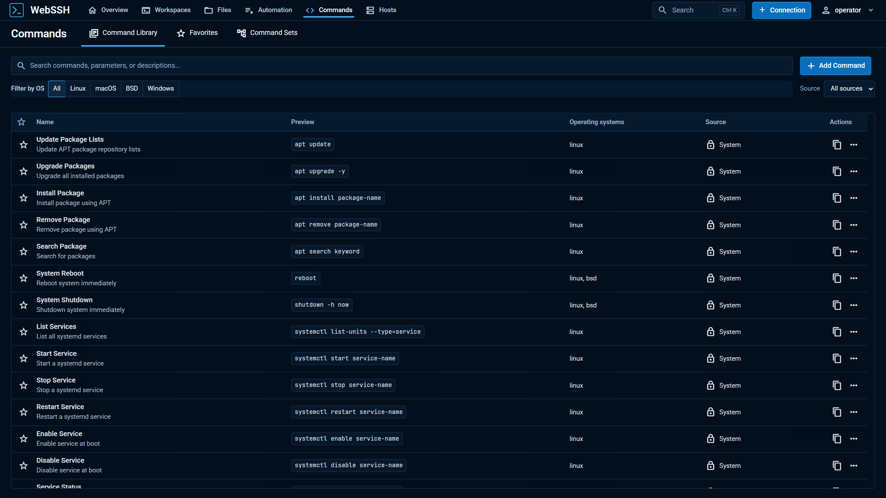

Browse the library, keep frequently used entries in Favorites, and build
reusable Command Sets. Each has its own label, icon, and color.

  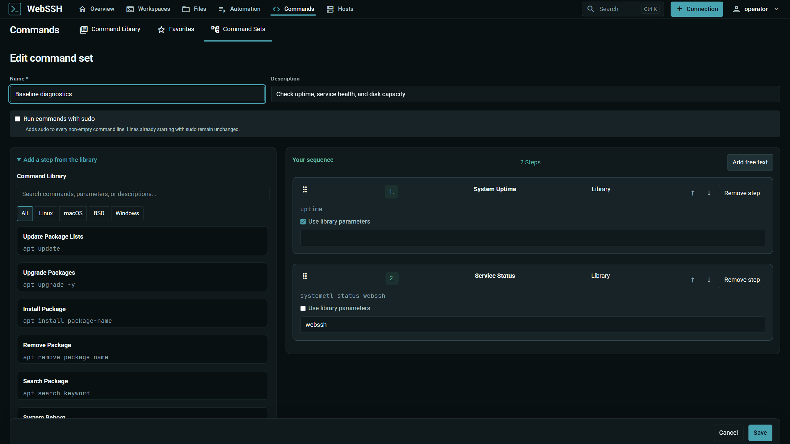

Arrange steps, review parameters, and assign a saved sequence to a connection.

### File workspace

  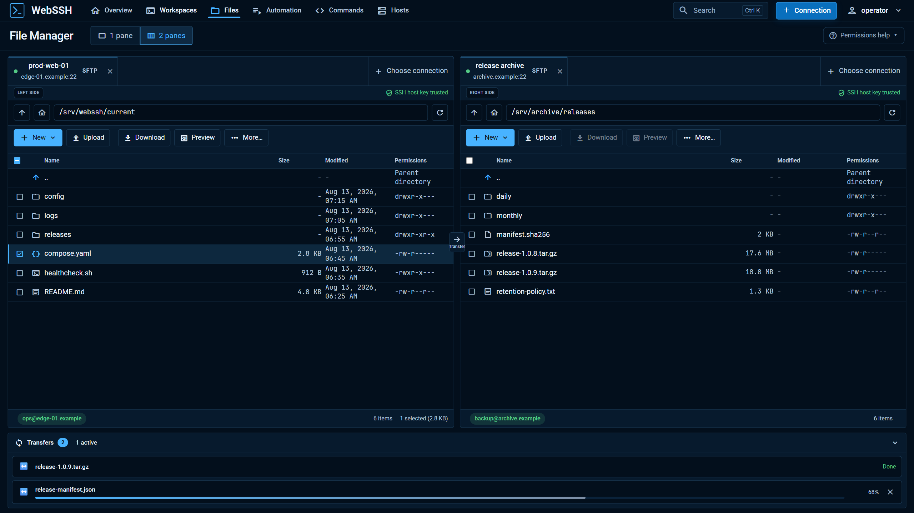

Each pane has an explicit source, endpoint, path, trust state, and selection.

Empty-file creation is available for SFTP and SMB. The SFTP Unix permission
editor is opt-in: uncomment `SFTP_CHMOD_ENABLED=true` under `environment` in
`docker-compose.yml`, then run `docker compose up -d --force-recreate webssh`.
It requires a compatible SFTP server and normal remote permissions. The file
manager shows setup help while disabled. Choose separate file and folder modes, optionally include folder contents,
and review a bounded server-side preview before applying. Progress and partial
changes remain visible; jobs stop on the first detected conflict or error.
See the [chmod manual](https://github.com/bifrost0x/webssh/wiki/SFTP-File-Workspace-and-Transfers#unix-permissions)
for production-overlay instructions and security boundaries.

### Review file changes before saving

  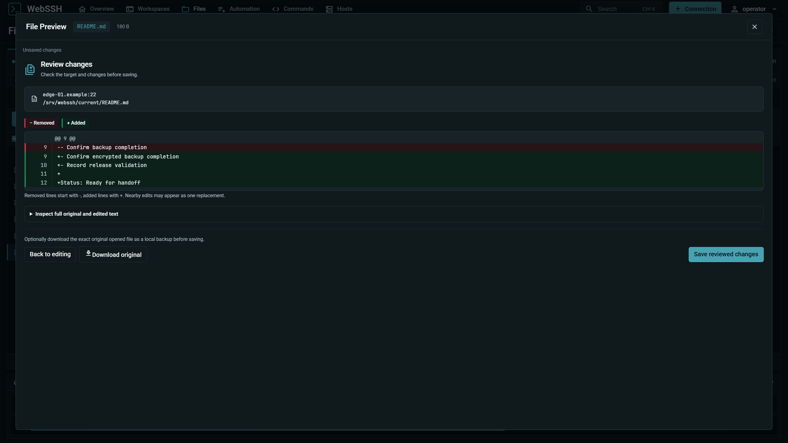

Check the target and changed lines, optionally download the original, then
explicitly save the reviewed content.

  
Preview the file editing workflow

  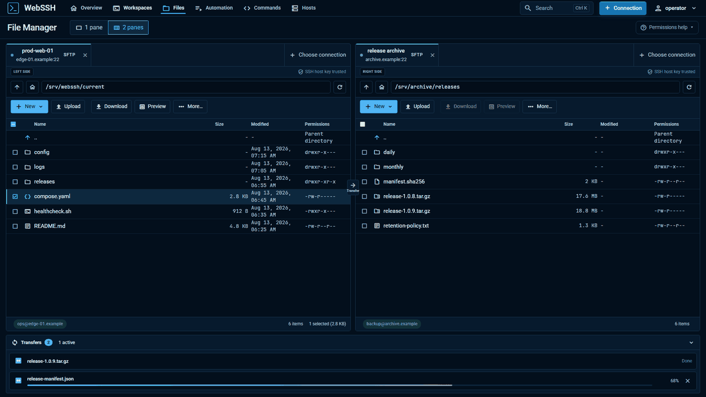

### Security Center

  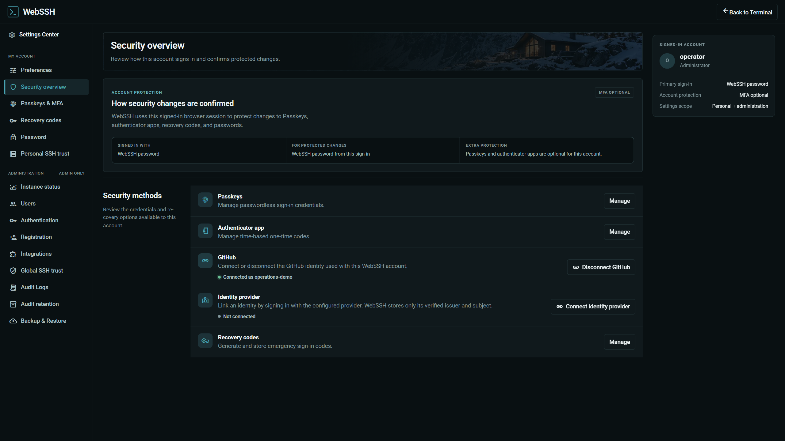

The Security Center explains how the current sign-in confirms protected
changes and keeps factors and SSH trust in one account-owned view.

### Mobile workspace

  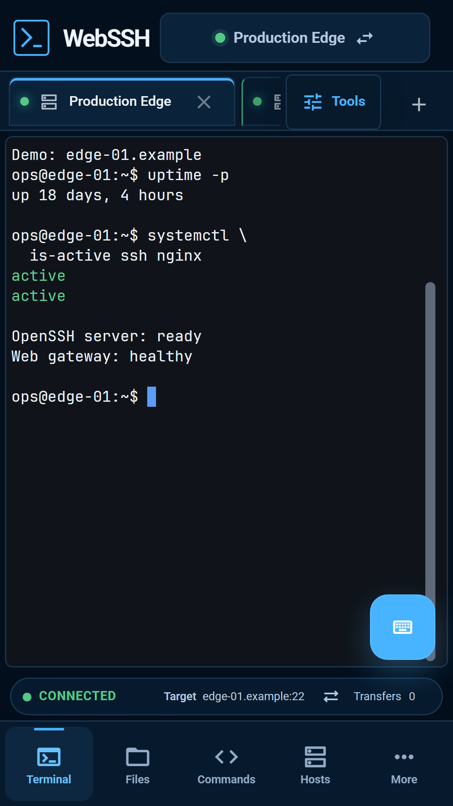

## Product tour

[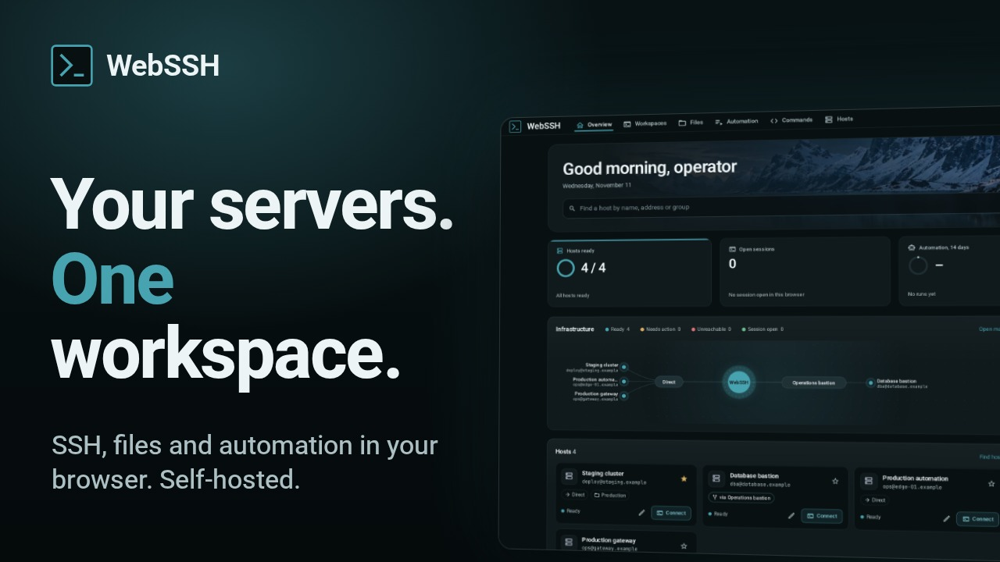](https://www.youtube.com/watch?v=mw_qXUnYYVs)

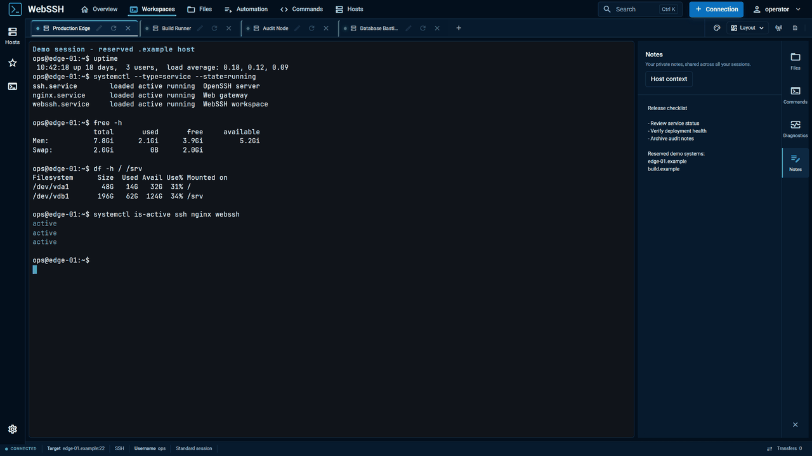
