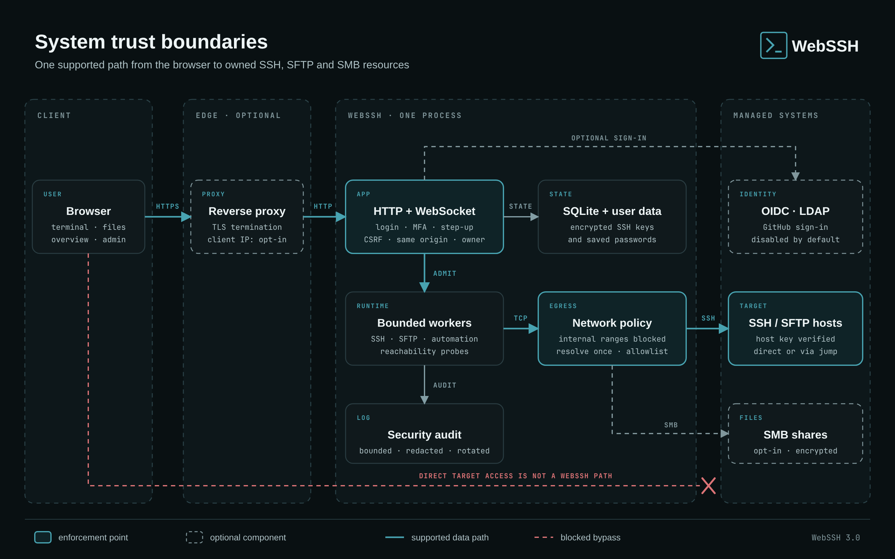

# Architecture and Runtime Lifecycle

WebSSH is one Go program. It serves the web interface and a JSON API over
HTTP, carries terminal and control traffic over one WebSocket per browser
tab, opens SSH, SFTP and SMB connections on the server side and keeps its
state in one SQLite database in `DATA_DIR/go/`. The 3.3 Python server
(Flask, Socket.IO, Paramiko, Gunicorn) was replaced in 3.4; its data is
migrated once at the first start ([Upgrading to 3.4](Upgrading-to-3.4)).

## Request and connection flow



Browsers do not connect directly to SSH targets. WebSSH terminates the
authenticated application session, checks ownership and policy, and then
opens the server-side SSH, SFTP or SMB connection.

```text
Browser
  |-- HTTPS pages, forms, JSON API --> HTTP edge (sessions, CSRF, origin, limits)
  |-- WebSocket <root>/ws ----------> realtime endpoint (subprotocol webssh.v1)
  |-- streamed transfers -----------> token-bound transfer routes
                                        |
                                        v
                              ownership, permission and quota checks
                                        |
                  +---------------------+---------------------+
                  |                     |                     |
          SSH client and dialer   file sources (SFTP, SMB)   SQLite database
                  |                     |                    + key material
          outbound network policy  outbound network policy
                  |                     |
            SSH servers            SFTP and SMB servers
```

Bulk file content is streamed over HTTP. The WebSocket carries terminal
traffic, control messages and bounded editor content; larger previews are
handed over through a one-use HTTP route.

## Code structure

The packages are organised by capability: sign-in and identity, sessions,
hosts, terminal, files, transfers, secrets, commands, automation,
operations, backup and the migration. The
[package map](https://github.com/bifrost0x/webssh/blob/main/docs/architecture/go-package-map.md)
lists them with their allowed imports; architecture tests enforce the map.
The decisions behind the design are recorded in the
[ADRs](https://github.com/bifrost0x/webssh/tree/main/docs/adr).

- `cmd/webssh` is the program and its commands.
- `internal/httpapi` is the HTTP edge: routing, sessions, CSRF and origin
  checks, request limits, forwarded headers, static files and pages.
- `internal/realtime` is the WebSocket endpoint with connection limits,
  revocation and flow control.
- `internal/ssh/client` is the one SSH dialer for terminals, Quick SFTP,
  automation, gateway and Tailscale SSH; `internal/netpolicy` decides which
  targets it may reach.
- `internal/store` owns the SQLite database; `internal/keyring` derives the
  keys for sealed secrets from `SECRET_KEY` and the key material.

## One process per data directory

Exactly one WebSSH server runs per `DATA_DIR`. Live SSH connections,
terminal streams, rate-limit counters and quotas are held in the process;
a lock file (`go/webssh.lock`) refuses a second server on the same data.
Several replicas behind a load balancer are not supported.

Rate limits live in memory and start empty after a restart. Redis is not
used.

## Live connections and capacity

The realtime endpoint admits at most `MAX_SOCKET_CONNECTIONS` connections
(48 by default) and `MAX_SOCKET_CONNECTIONS_PER_USER` per account (8).
A refused connection is closed with code 1013 and a message that names the
limit. Each connection has a bounded output queue; a terminal that falls
behind is detached and resumes with a replay instead of blocking others.

HTTP requests are served concurrently by the Go runtime; there is no
thread pool to divide between HTTP and WebSocket traffic. The 3.3 variables
`GUNICORN_THREADS` and `BACKGROUND_WORKERS` have no effect of their own; they
are still checked as in 3.3 (`GUNICORN_THREADS` must exceed
`MAX_SOCKET_CONNECTIONS` by at least 4), so a way back to 3.3 still starts.

SSH sessions are limited by `QUOTA_SSH_SESSION_GLOBAL` (10) and
`QUOTA_SSH_SESSION_PER_USER` (5); see the
[Configuration Reference](Configuration-Reference) for the other quotas.

## Background work

Periodic and on-demand work (LDAP revalidation, platform detection,
reachability, schedules, transfer cleanup) runs as
registered background jobs. Each job has one owner, a timeout and a bounded
queue. Job state is stored in the database: a periodic job continues from
its last run after a restart, a run missed during downtime runs once, and
an interrupted run is reported instead of repeated. The operations view in
Administration lists the jobs.

## SSH and SFTP lifecycle

SSH connections belong to an authenticated user and consume quotas.
Connection setup, channel setup and remote commands have time and output
limits. Quick SFTP connections stay open while queued or active transfers
still use them.

Persistent tmux metadata survives a browser disconnect and a server
restart; the tmux session itself lives on the SSH server. WebSSH's own
connections do not survive a restart.

## Graceful shutdown

On SIGTERM or SIGINT WebSSH:

1. reports not ready on `/ready`;
2. stops accepting new work and closes live connections;
3. waits for running work up to `RUNTIME_SHUTDOWN_GRACE_SECONDS`;
4. closes the database cleanly, so no `-wal` or `-shm` file remains;
5. exits. A second signal ends it at once.

Keep the drain period of a proxy or load balancer aligned with
`RUNTIME_SHUTDOWN_GRACE_SECONDS`.

## Maintenance mode

Restore, secret rotation and a changed 3.3 data source put WebSSH into
maintenance. `/health` stays a liveness check, `/ready` answers 503, live
connections are closed with code 4503 and new sign-ins and changes are
refused. After a web restore WebSSH restarts inside the running process.

## Frontend architecture

The frontend uses vanilla JavaScript and CSS without a build-time
application framework. Browser libraries are pinned in `package.json`,
vendored locally and checked for integrity; the binary embeds them. There
are no runtime CDN dependencies, so the frontend works offline and fits
the Content Security Policy.

`file-directory-requests.js` owns the file panes' request, cursor,
cancellation and timeout lifecycle. `SFTPFileManager` supplies pane state,
source capabilities, the connection and presentation callbacks. Syntax
highlighting is loaded from the vendored assets only when a text preview
needs it. Plain text remains available if loading fails, and delayed
highlighting cannot replace a newer preview.
