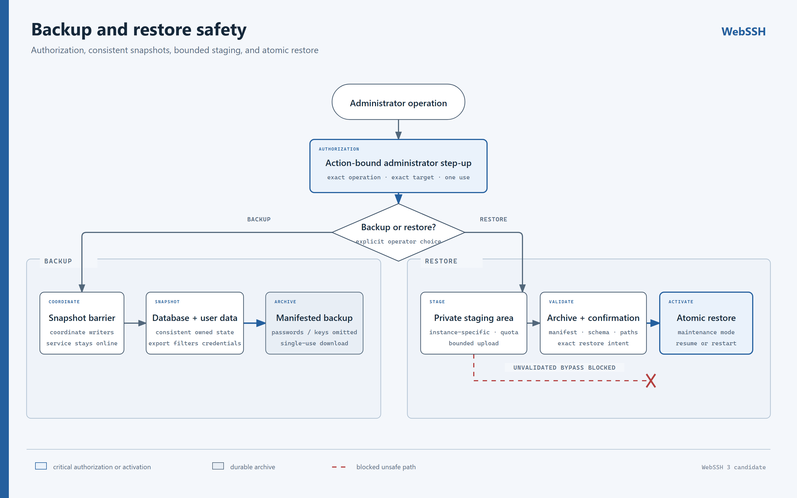

# Backup, Restore, and Secret Rotation

WebSSH provides native administrator and CLI workflows for backing up persistent state, validating archives, restoring an installation, and rotating a container-managed `SECRET_KEY`.

Backups remain highly sensitive even though native exports exclude saved remote passwords and SSH keys. An archive can contain user configuration, host information, the authentication database (including password hashes and MFA data), provider secrets such as the admin-managed encrypted GitHub client secret, and the persisted application secret. Store downloaded archives encrypted and off-host with restricted access.

## What a native backup contains

The archive covers persistent `DATA_DIR` configuration and account state. Native exports exclude named password stores (`credentials.json`), legacy `automation-vault.json`, SSH key directories (both metadata and private keys), and quarantined `deleted_users` data. Transient logs, temporary uploads, incomplete transfers, and runtime-only SSH channels are also excluded.

These are specific file exclusions, not general secret detection: commands, notes, profiles and retained run history can still contain manually embedded secrets. Historical archives are not rewritten and may still contain remote credentials. Protect their retention and rotate remote credentials when old copies must stop working.

Current archives use format version 2. The verifier also understands legacy format version 1/schema 0 for compatibility. Validation checks the manifest, file checksums, declared sizes, member paths, member count, compression behavior, and archive-wide limits before restore.

## Online backup in the web interface



Backup and restore share the same authorization boundary but use different safe
paths. A backup coordinates writers before collecting consistent state. A
restore stays in an instance-specific, quota-bounded staging area until archive
validation and exact operator confirmation succeed.

An administrator can create a consistent backup while the service is online. SQLite uses its backup API and file writers are coordinated so that the archive represents a coherent point in time.

The completed download is one-time, session-bound, and expires after `BACKUP_DOWNLOAD_TTL` seconds, which defaults to 600. Temporary archive construction occurs outside `DATA_DIR` in an instance-specific namespace.

Do not rely on the short-lived browser download as retention. Move the archive immediately to encrypted, access-controlled backup storage.

## Restore in the web interface

Restore is deliberately disruptive and strongly confirmed. Normal web and CLI restore ignore excluded credential files even in older archives and clear existing copies to prevent accidental reuse by a different restored account. After restore, reimport SSH keys, recreate saved remote passwords and reassign credentials to hosts, jump hosts and SMB sources. Review and explicitly re-enable schedules before unattended execution.

Online restore is enabled only when `BACKUP_TEMP_DIR` is an absolute, private,
durable directory outside `DATA_DIR` and `BACKUP_RECOVERY_DURABLE=true` records
the operator's explicit acknowledgement. The rollback journal and emergency
archive live there, so the storage must survive both process termination and
container recreation. The repository Compose file provides the separate
`webssh_recovery` volume. A default system `/tmp` directory is suitable for
backup construction, but intentionally does not enable online restore.

1. Upload the archive.
2. Let WebSSH validate format and safety limits.
3. Review the restore target and warnings.
4. Complete the action-bound restore-prepare Step-up and acknowledge the sensitive operation.
5. Submit the issued session-bound confirmation token, the exact `RESTORE` phrase, and destructive-restore confirmation with a second action-bound Step-up.
6. WebSSH enters maintenance mode and stops accepting new work.
7. Active sessions and transfers are closed.
8. An emergency rollback archive is created.
9. Persistent state is replaced and sessions are invalidated.
10. The process terminates intentionally so the service manager can start a clean runtime.

Emergency rollback archives and secret-rotation recovery snapshots are private internal recovery material, separate from downloadable exports. They retain encrypted credentials so a failed operation can recover the original state; normal restore does not import those credentials. Restrict recovery storage access and manage its retention and cleanup separately from exported backups.

If an interruption occurs during replacement, the restore workflow attempts rollback from the emergency archive. On restart, the durable recovery directory remains available for diagnosis or recovery. Still take an independent backup before every restore and keep it outside the instance.

## CLI backup and restore

CLI operations require every WebSSH process that uses the same `DATA_DIR` to be stopped. This avoids concurrent writers outside the coordinated web workflow.

Discover exact options in the installed version:

```bash
flask --app start:app backup create --help
flask --app start:app backup verify --help
flask --app start:app backup restore --help
```

For a container deployment, execute the command in a one-off container with the same data volume and configuration, while the normal application container is stopped.

Without `--destination`, `backup create --confirm-offline` retains the parent of
`DATA_DIR` as its default when writable. On a read-only or permission-restricted
parent, it writes to the private instance directory under `BACKUP_TEMP_DIR` and
prints the exact archive path. Explicit destinations are never redirected.
The supplied Compose recovery volume persists fallback archives; custom paths
must provide their own durability. Copy the result to encrypted off-host storage.
An archive in a one-off container's writable layer disappears with that container.

## Safety limits

Default operational limits include:

| Setting | Default |
|---|---:|
| Upload size | 1 GiB |
| Operation timeout | 30 minutes |
| One-time download lifetime | 10 minutes |
| Archive members | 10,000 |
| Individual uncompressed file | 1 GiB |
| Total uncompressed content | 10 GiB |
| Compression ratio | 200:1 |
| Manifest size | 10 MiB |

Reverse-proxy body-size and timeout settings must allow the same operation. Do not raise limits without assessing disk exhaustion and decompression-bomb risk.

## Secret-key rotation

The supported rotation command re-encrypts persisted secrets when WebSSH manages `DATA_DIR/secret_key`:

```bash
flask --app start:app rotate-secret-key --help
```

All WebSSH processes must be stopped. Take and verify a backup first. The command re-encrypts per-user SSH keys, named connection passwords, TOTP values and the GitHub client secret, and invalidates signed session state. It verifies staged credential data before publishing the new secret and restores original bytes if publication fails. Its private recovery snapshot retains the original encrypted credentials; the ordinary backup export does not. A partial or interrupted manual replacement of the application secret can make persisted credentials unreadable.

If `SECRET_KEY` comes from an external environment variable or secret manager, rotating only the external value is not sufficient. Plan a controlled migration that keeps the old key available while persisted SSH keys, named connection passwords, TOTP values, and the GitHub App client secret are re-encrypted. The built-in command is scoped to the container-managed persisted secret.

## Restore drill

Test the full sequence on an isolated instance:

1. Create and download a backup.
2. Verify it with the CLI.
3. Start a disposable instance with an empty data volume.
4. Restore the archive.
5. Confirm local, LDAP/OIDC where applicable, Passkey and host-key data.
6. Reimport SSH keys, recreate saved passwords and reassign credentials; test SSH, SFTP and SMB as applicable.
7. Review schedules and explicitly re-enable only the intended ones.
8. Confirm that old browser sessions are invalid.
9. Record the observed recovery time and required secret material.

An untested archive is not a verified recovery capability.
