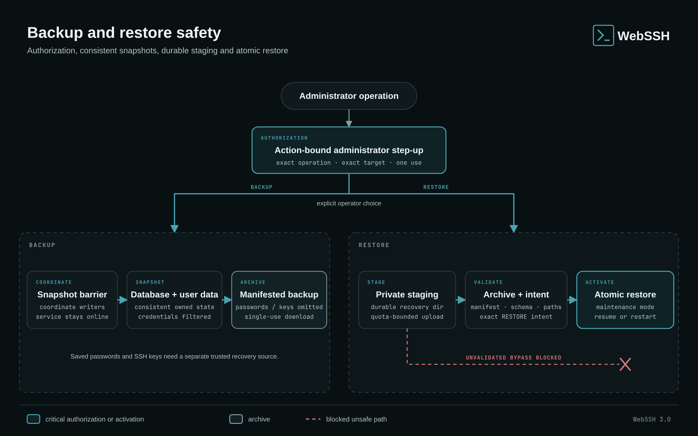

# Backup, Restore, and Secret Rotation

WebSSH provides administrator and command-line workflows for backing up
persistent state, checking archives, restoring an installation and rotating
the generated `SECRET_KEY`.

Backups are sensitive. An archive contains the database with user
configuration, host information, password hashes, second factors and
provider secrets such as the encrypted GitHub client secret, and by default
the application secret and key material that decrypt them. Store downloaded
archives encrypted and off the host with restricted access.

Upgrading from 3.3? Backups made with 3.3 restore on 3.4; 3.4 backups do
not restore on 3.3. See [Upgrading to 3.4](Upgrading-to-3.4).

## What a backup contains

A backup is a tar archive in the format `webssh-go-backup` with a
`manifest.json` that records the format version, the reason, whether the
secret is included and a SHA-256 for every member. Members are stored below
`data/`:

| Member | Content |
|---|---|
| `data/go/webssh.db` | the database, taken as a consistent snapshot |
| `data/secret_key` | `SECRET_KEY`, unless `--without-secret-key` is given |
| `data/go/keyring-material` | the key material that, together with `SECRET_KEY`, protects stored secrets |
| `data/<path>` | only in the backup `legacy purge` writes: left-over files of the 3.3 data |

What an archive restores depends on its reason:

- **Exports** (online backup, `backup create`) leave out saved SSH keys,
  saved passwords, their assignments and the legacy automation vault. After
  restoring an export, upload SSH keys again, recreate saved passwords and
  reassign them to hosts, jump hosts, SOCKS5 proxies and SMB shares.
- **Recovery archives** (written by `legacy purge`, `migrate --replace` and
  `rotate-secret-key`) keep them, so a failed operation can return to the
  original state. The CLI restores their credentials; the web restore never
  does.

Copies of deleted accounts (`go/deleted_users/`), logs, temporary uploads,
transfers and live SSH sessions are never part of a backup.

These are fixed exclusions, not secret detection: commands, notes,
profiles and run history can still contain secrets typed into them.

## Online backup in the web interface



An administrator creates a backup in **Settings Center → Backup & Restore**
while WebSSH runs. The archive can be downloaded once, from the same browser
session, within `BACKUP_DOWNLOAD_TTL` seconds (600 by default). It is built
in a private directory below `BACKUP_TEMP_DIR`, outside `DATA_DIR`.

The browser saves the download as `webssh-backup.zip`; the content is a tar
archive. Rename it to `.tar` if you open it with other tools.

Do not rely on the short-lived download as retention. Move the archive
immediately to encrypted, access-controlled backup storage.

## Restore in the web interface

Restore is disruptive and confirmed twice:

1. Upload the archive. WebSSH checks format, manifest, hashes and limits.
2. Review the summary and the warnings.
3. Confirm with a step-up and acknowledge the sensitive operation.
4. Enter the exact `RESTORE` phrase and confirm with a second step-up.
5. WebSSH enters maintenance: `/ready` answers 503 and every live
   connection is closed.
6. The archive is staged and checked once more, then the database, key
   material and, where it applies, `secret_key` are installed under a
   journal that keeps the previous state for rollback.
7. WebSSH restarts inside the running process. The container keeps
   running.

After a restore every user signs in again; step-up confirmations,
bootstrap codes and known-device cookies end, and schedules need a new
approval. The restore state is kept in `DATA_DIR/go/restore-status.json`,
so an interrupted restore is completed or rolled back at the next start.
While a failed rollback is unresolved, `/ready` and the sign-in page answer
503 until `webssh backup restore` succeeds. That command keeps the files of
the failed restore (the previous and the restored database) as
`DATA_DIR/go/failed-restore-<id>/` and names them; remove them once they are
no longer needed. `rotate-secret-key` is refused until then.

### SECRET_KEY on restore

- When WebSSH manages the key in `DATA_DIR/secret_key`, restoring a 3.4
  archive installs the archive's key together with its database, so an
  archive from another host works. The previous key is kept for rollback.
- While the 3.3 data of a migrated installation still exists (before
  `webssh legacy purge`), `DATA_DIR/secret_key` belongs to that data and is
  never changed. An archive made with another key is then sealed again
  under the active key and key material while it is staged, with the same
  steps as `rotate-secret-key`. SSH keys, saved passwords, second factors
  and the GitHub client secret open as before, and 3.3 still starts on its
  own data. An interrupted restore changes nothing.
- When `SECRET_KEY` is set in the environment and differs from the key in
  the archive, the restore is refused before anything changes. Restore with
  the `SECRET_KEY` the archive was made with.
- An archive made with `--without-secret-key` needs the same `SECRET_KEY`
  on the target.
- A 3.3 archive is restored through the migration: the environment value
  wins, otherwise the archive's `data/secret_key`, and the restored secrets
  are sealed again with the installation's key material.
  Its migration report is kept as `DATA_DIR/go/restore-report-<UTC>.json`
  (mode 0600) once the restore is active, next to the report of the first
  migration.

3.4 archives are checked strictly. Links, devices, absolute or
non-canonical paths, `..`, backslashes, members below `go/` or `logs/`
other than the database and the material, and members missing from the
manifest are refused. 3.3 archives (format v1 and v2) are read as
tolerantly as 3.3 read them.

## CLI backup and restore

The CLI commands need every WebSSH server that uses the same `DATA_DIR` to
be stopped; they take the same lock as the server. Run them in a one-off
container with the same volumes and configuration:

```bash
docker compose stop webssh
docker compose run --rm webssh backup create --confirm-offline
docker compose run --rm webssh backup verify /app/recovery/<archive>.tar
docker compose run --rm webssh backup restore /app/recovery/<archive>.tar --confirm-offline
docker compose up -d
```

| Command | Notes |
|---|---|
| `backup create [--destination ARCHIVE] [--without-secret-key] --confirm-offline` | Without `--destination` the archive goes next to `DATA_DIR` when that directory is writable, otherwise below `BACKUP_TEMP_DIR`; the command prints the path. In the official image `/app` is read-only, so the archive lands in the recovery volume. |
| `backup verify ARCHIVE` | Checks manifest, hashes, limits and the database without restoring. |
| `backup restore ARCHIVE --confirm-offline [--recovery-snapshot]` | Restores 3.4 archives by their reason and 3.3 archives as exports. `--recovery-snapshot` restores a 3.3 recovery snapshot with its SSH keys and saved passwords. |

An archive written inside a one-off container's own file system disappears
with the container. Write to a mounted volume and copy the result to
encrypted off-host storage.

The 3.3 forms (`/app/entrypoint.sh flask --app start:app backup …`) keep
working until the next major release.

## Safety limits

| Setting | Default |
|---|---:|
| `BACKUP_UPLOAD_MAX_SIZE` | 1 GiB |
| `BACKUP_OPERATION_TIMEOUT` | 30 minutes |
| `BACKUP_DOWNLOAD_TTL` | 10 minutes |
| `BACKUP_MAX_MEMBERS` | 10,000 |
| `BACKUP_MAX_FILE_SIZE` | 1 GiB |
| `BACKUP_MAX_TOTAL_SIZE` | 10 GiB |
| `BACKUP_MAX_COMPRESSION_RATIO` | 200:1 |
| `BACKUP_MAX_MANIFEST_SIZE` | 10 MiB |

`RATELIMIT_BACKUP_CREATE`, `RATELIMIT_BACKUP_DOWNLOAD`,
`RATELIMIT_BACKUP_UPLOAD` and `RATELIMIT_BACKUP_RESTORE` limit the online
actions per administrator. Reverse-proxy body-size and timeout settings
must allow the same operation. Do not raise limits without assessing disk
exhaustion.

`BACKUP_RECOVERY_DURABLE` is still accepted but no longer required: the
rollback state of a restore lives in `DATA_DIR`, on the same volume as the
data it protects.

## Secret-key rotation

`rotate-secret-key` replaces the generated `DATA_DIR/secret_key` and seals
every stored secret again: SSH keys, saved passwords, TOTP secrets, the
GitHub client secret and the other sealed records.

```bash
docker compose stop webssh
docker compose run --rm webssh rotate-secret-key --confirm-offline
docker compose up -d
```

- It refuses while a WebSSH server uses the data directory, while
  `SECRET_KEY` comes from the environment (the next start would load that
  value instead) and while the 3.3 data still exists. Run
  [`legacy purge`](Upgrading-to-3.4#removing-the-33-data) first after an
  upgrade from 3.3.
- Before it changes anything it writes a recovery archive
  (`webssh-backup-<UTC>.tar`) next to `DATA_DIR` or below
  `BACKUP_TEMP_DIR` and prints the path. Keep `BACKUP_TEMP_DIR` on a
  persistent volume, as the supplied Compose files do with `/app/recovery`.
- The database commit is the switch point. A rotation interrupted by a
  crash completes at the next start.
- All browser sessions end, and so do enrollments, two-factor sign-ins,
  passkey ceremonies, step-up confirmations and open bootstrap codes.
  Browser-local data tied to the key is lost.
- WebSSH does not restart by itself; start the service afterwards.

If `SECRET_KEY` comes from an environment variable or a secret manager,
changing only the external value makes every stored secret unreadable.
Plan a migration that keeps the old key available while the secrets are
sealed again, or switch to the generated key file first.

## Restore drill

Test the full sequence on an isolated instance:

1. Create and download a backup.
2. Check it with `backup verify`.
3. Start a disposable instance with an empty data volume.
4. Restore the archive.
5. Confirm local, LDAP or OIDC sign-in where applicable, passkeys and host
   keys.
6. Upload SSH keys, recreate saved passwords and reassign them; test SSH,
   SFTP and SMB as applicable.
7. Review schedules and approve only the intended ones.
8. Confirm that old browser sessions are invalid.
9. Record the recovery time and the secret material it needed.

An untested archive is not a verified recovery capability.

## Recovery checklist in the application

In **Settings Center → Backup & Restore**, expand **Backup coverage** to
see what an export includes and excludes. The **Recovery check** opens a
checklist for the signed-in account: for each host whether its key or
password is ready, whether its jump host or SOCKS5 proxy exists and whether
its host key is trusted, and which schedules need review. Acknowledging the
notice applies to the current restore only. The checklist does not import
credentials, approve host keys, test connectivity or enable schedules.
