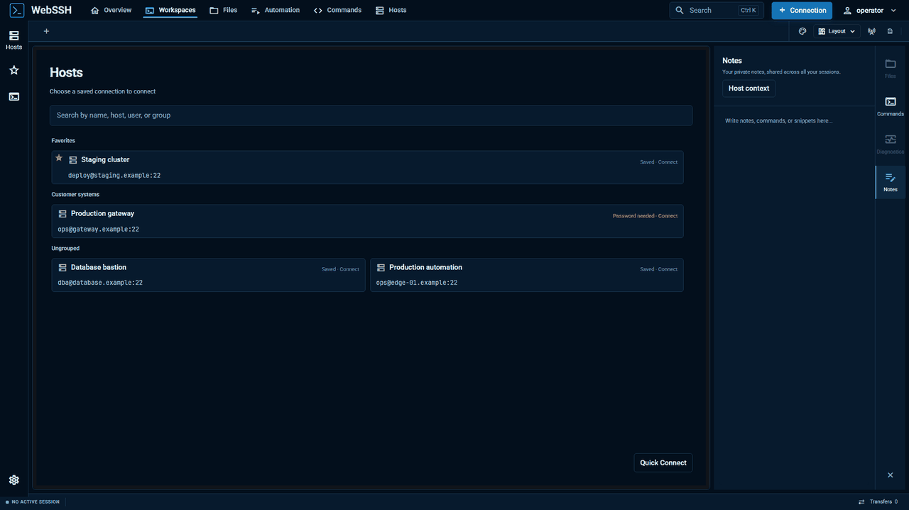

# Profiles, Jump Hosts and Commands

Saved connection data is private to each WebSSH account. Profiles intentionally
exclude plaintext SSH, jump-host and SOCKS5 proxy passwords. Optional saved
passwords are encrypted separately and assigned to the corresponding host or route; see
[Credentials](../credentials.md).

## Find hosts in a network

**Find hosts** in the Hosts view, or on the overview's Hosts panel, looks for
SSH and SFTP servers in a network range you enter (at most 256 addresses and
three ports). It runs only when you start it and is not offered in the
`production` profile.

- Each address and port gets one TCP connection. WebSSH reads the greeting an
  SSH server sends by itself and closes the connection; it never logs in and
  sends no credentials.
- Attempts are paced to about three per second with at most three in flight,
  so a /24 takes roughly 90 seconds. The scan is not hidden: firewalls or
  intrusion detection may record it. Scan only networks you are responsible for.
- The SSH network policy applies. Addresses that SSH may not reach are skipped.
- Results show the address, reverse DNS name, SSH software and a platform hint,
  and mark endpoints already saved. **Add** opens the new-host form prefilled
  with name, address and port; leaving it asks before discarding the values.
- One scan per account runs at a time; ten scans per account per hour. Logging
  out stops the account's scans.

## Saved profiles

A profile can store:

- display name;
- hostname, port, and remote username;
- selected stored key;
- selected jump host or SOCKS5 proxy;
- tmux preference;
- Tailscale authorization mode when allowed;
- post-connect startup behavior;
- flat group and sort position;
- favorite state.

Profiles without a usable saved credential open the connection form at the required field.
Profiles that need no password, such as a usable stored key or authorized
Tailscale mode, can launch directly from an empty pane.

Use **Duplicate** in the Hosts manager to create a new draft from an existing
profile. The draft copies connection, authentication-reference, route,
group, and post-connect settings, adds a localized “copy” suffix to the
bounded name, and has no source profile ID. Saving therefore creates a separate
profile and never overwrites the original. Passwords remain excluded because
they are never stored in profiles.

## Platform and service detection

When a saved host in **Automatic** icon mode connects, WebSSH runs one
read-only probe over a separate SSH channel and stores what it recognised with
the profile. It runs at connect time only, at most once a week per host, and
never on a schedule of its own. Quick connections are not probed. The probe
needs `/bin/sh` on the host and runs under it from sh, bash, zsh, fish, csh or
tcsh as the login shell: it is sent as one single-quoted line without the
characters csh and tcsh would still expand there (a newline, or `!` as a
history reference). A BSD csh with the classic 1024-character word limit may
refuse it; then nothing runs and the host is shown as not determinable. nu has
not been tried.

The probe collects:

- the platform, from `/etc/os-release` (`ID`, `ID_LIKE`, `VERSION_ID`), the
  kernel name and fixed markers such as Proxmox VE, Proxmox Backup Server,
  TrueNAS, OPNsense, pfSense, Unraid, Synology, QNAP, OpenWrt or UniFi;
- the distribution family and version, and the distribution ID when it is not
  in the catalog (for example Omarchy on Arch Linux, shown with the Arch Linux
  icon and marked as derived from its family);
- the virtualization kind (bare metal, VM, LXC, container or WSL), whether the
  system boots into a graphical target and, on Proxmox VE, the number of guests;
- known services from active systemd units, fixed install paths and snaps, at
  most 24 per host; on a host with more, VPN and overlay networks (WireGuard,
  Tailscale, ZeroTier, OpenVPN) and one service per host role (for example
  Home Assistant, Nextcloud, Immich, Jellyfin, Vaultwarden) are kept first,
  then the other applications, and container runtimes, web servers and
  databases are left out first;
- where the SSH user may already use Docker or Podman without sudo, the image
  names of running containers, mapped to known services, and whether that
  access worked. Both are asked only through an existing local daemon socket
  (`/var/run/docker.sock`, the rootless Docker or the Podman API socket);
  Docker contexts and `DOCKER_HOST` are never followed. On systemd hosts
  Docker is not asked while `docker.socket` is active and `docker.service` is
  not, because the query would start the stopped daemon; the same holds for
  a rootless socket with the user's own service manager, and when that
  manager cannot be reached. Docker is then listed without its access state.
  A daemon that holds its own socket (the snap, vendor units, a `dockerd`
  started by hand) and hosts without systemd are asked as usual. Podman is
  asked through its socket even if `podman.socket` starts the Podman API
  service for that; the service exits when idle and starts no containers. A
  Docker socket that links to the Podman socket, as podman-docker sets it
  up, counts as Podman.

Only values that map to a fixed catalog entry or a strict pattern are stored.
WebSSH never stores raw command output, host names, IP addresses, user
names, file contents, process lists or container names, installs nothing,
changes nothing and runs nothing with elevated rights.

Windows, MikroTik RouterOS and Cisco IOS hosts are recognised only from their
SSH greeting. **Find hosts** and the reachability check read it without logging
in, so what they read only labels the host: it never removes stored facts and
never decides whether the probe runs. On connect, WebSSH takes the greeting
from the logged-in connection, whose host key was verified. When it names one
of these systems, the probe does not run and what an earlier probe found at
that endpoint is dropped. When it names another platform, or none, a stored
Windows, MikroTik or Cisco hint is replaced and the probe keeps its usual
schedule. A greeting that differs from the one of the previous logged-in
connection runs the probe on that connection when it last ran more than a day
ago, so greetings that alternate ask it at most once a day; what the overview
read without logging in never counts as such a change.
A Dropbear greeting marks a host as embedded until a connection detects more. When a host answers
with something other than the probe output, for example a forced command or a
menu, the profile records that detection is not possible, keeps any facts an
earlier run found and does not run the probe again for a week. A host that
prints nothing within four seconds, or only colour or window title sequences,
may only have a slow login shell, so it is asked again after a day and an
earlier detection stays as it is. When the probe starts answering but
does not finish within four seconds, for example on a hung network mount,
stored facts stay as they are and it runs again after a day. The same applies
to any other failure once the probe was sent, such as a connection that closes
meanwhile. If the connection store is full, the attempt is kept in memory
instead, so the probe still does not repeat on every login. That memory
belongs to the server process: it is lost when WebSSH restarts, and each
server process keeps its own.

The host icon shows where its platform came from: a manual choice, a
detection, the SSH greeting, the host name, a detection that found no known
platform, or "not detected yet". Choosing a
manual icon turns detection off for that host. A role assigned to the host
(the **Role** field, or the `role_override` field of a host import) does not.

## Private host context

Open **Host context** from a saved host's action menu, or from the active
session's **Notes** tools. Host notes are separate from the global notepad.
Each saved profile has its own private context, even when two profiles use the
same hostname. A session opened without its saved host, for example through
Quick Connect, uses the context of the saved host with the same destination,
user and route; with several, the most recently edited one. A connection
that matches no saved host has no context.

Context supports up to 100000 characters of notes, 20 favorite absolute remote
directory paths, and references to 20 command sets belonging to your account.
Use **Save** to persist changes. A concurrent change preserves your local draft
and reports a conflict; copy your changes before choosing **Discard draft and
reload**. Drafts also survive switching contexts within the open page; reloads
retain saved content only.

For a connected session explicitly launched from that saved profile, directory
buttons open its SFTP source and command-set buttons open the existing command
launcher. Command insertion and execution retain the launcher's normal preview
and confirmation behavior. Actions stop when the active session changes. Missing
or deleted command sets appear unavailable and can be removed from assignments.
Opening context never establishes or restores an SSH connection.

Context is stored in the account's `host_context.json`, with a 4 MiB account
quota, and included in normal application backups. Deleted profiles cannot
access their context; orphaned entries are pruned on the next context write.

## Host roles and where they are shown

Every host has a role: Hypervisor, Backup, Storage, Containers, Documents,
Photos, Media, Cloud, Smart home, Network, Monitoring, Development, Passwords,
Database, Web, Workstation or Server. WebSSH works it out in the browser from
the platform and services that the connect-time probe stored (see above); it
adds no request, no probe and no setting on the server. The rules are checked
in this order, and the first one that matches names the role. Each rule matches
on the platform or on a service:

1. Hypervisor: Proxmox VE.
2. Backup: Proxmox Backup Server.
3. Storage: TrueNAS, Unraid, Synology, QNAP.
4. Photos: Immich, PhotoPrism.
5. Documents: Paperless.
6. Cloud: Nextcloud, ownCloud, Seafile.
7. Media: Jellyfin, Plex, Emby.
8. Smart home: Home Assistant.
9. Network: OPNsense, pfSense, OpenWrt, MikroTik, Cisco, Ubiquiti, or
   Pi-hole, AdGuard.
10. Monitoring: Grafana, Prometheus, Uptime Kuma, Zabbix, Netdata.
11. Development: Gitea, GitLab.
12. Passwords: Vaultwarden.
13. Database: MariaDB, PostgreSQL, Redis, MongoDB, InfluxDB.
14. Web: nginx, Apache, Caddy, Traefik, Nginx Proxy Manager, HAProxy.
15. Containers: the Docker platform, or Docker, Podman, Portainer, k3s,
    Watchtower, Dozzle as the only services.
16. Network: WireGuard, Tailscale, ZeroTier, OpenVPN as the only services.

Because a service rule can rank above a platform rule, a router platform that
also runs Jellyfin is a Media host, not a Network host. Rules 13 to 15
describe hosts that run nothing but infrastructure: Database allows only
databases, web servers and container tools, Web only web servers and container
tools, and Containers only container tools. One more application and the host
does not match them. VPN and overlay networks (WireGuard, Tailscale, ZeroTier,
OpenVPN) say how a host is reached, not what it is: the other rules ignore
them, a host that runs nothing else is a Network host (rule 16), and their
logos come after all other services. A host that boots into a graphical
target and matched nothing is a Workstation; anything else is a Server.

Only a chosen platform, a detected one or a distribution family derived from
detection (for example Debian-based) can name a role through the platform. A
greeting or host-name hint never does. In the host editor, the **Role** field
offers **Automatic** and the 17 roles. A manual role only changes how the host
is shown: detection keeps running and keeps its schedule.

Each role has its own accent colour, tuned per theme; forced-colors mode uses
the system colours.

The overview shows, per host:

- a role pill, a card edge and tint in the role colour, and the platform icon
  on a role-tinted tile with a badge for the virtualization kind;
- the system line (for example `Debian 12`, or the distribution and its
  family for a derived one);
- up to five service logos with `+n` for the rest, the role's own service
  first; a name or hover text names each logo;
- a guest count on hypervisors and a hint when running containers could not be
  read because the SSH user may not use the Docker socket;
- **Host profile**, an expandable section with system, machine, services,
  role and how it was reached (manual, derived from a platform or service, the
  graphical desktop, or default) and the detection source with its date. It
  says when the facts are older than seven days; they are refreshed on the
  next connection.

Search in the overview also matches role, platform and service names. The
classic overview layout keeps its compact rows: platform icon, virtualization
badge, role pill and up to three service logos, without tint or profile.

In the workspace, tabs carry the role colour as an edge with up to two service
logos, dropping logos before a host name is cut. Above each terminal in the grid, an
identity line names the role, the host and the system, with up to four service
logos; in window mode the same information sits in the window's title bar. Rows in the host rail on the left have
a role edge and up to four service logos, and a **Group / Role** switch groups
the rail by role instead of by group. The choice is stored in the browser
(`localStorage`), not on the server, and the switch does not exist in the
classic layout.

All of this uses only what detection read while you were connected anyway.
Facts that are missing or outside the fixed catalogs are left out, and a host
that was never detected is shown as a Server without services.

## Favorites and groups

The connection manager provides:

- a Favorites section;
- named flat groups;
- an Ungrouped section;
- search by name, host, user, or group;
- collapsed group state in the browser;
- drag-and-drop ordering and movement between groups.

Groups are flat labels, not nested folders. Favorite profiles are promoted into
the Favorites section. Remove a profile from favorites before relying on normal
group ordering.

Moving the last profile out of a real group requires an explicit confirmation
because the empty group ceases to exist.

## Jump hosts

Jump hosts are saved separately so several target profiles can reuse one
bastion. Select the jump host while editing a profile.

Open **Hosts > Jump Hosts**, then choose **Edit** beside a saved entry to change
its name, address, port, username, authentication method, or stored-key reference.
Saving keeps the same Jump Host ID, so dependent profiles use the updated
configuration on subsequent connections. Existing SSH sessions are not restarted.
Passwords are never stored in plaintext in Jump Host records. Enter one when
connecting or select an explicitly saved password when the feature is enabled.
Changing the selected Jump Host in Quick Connect clears the previous bastion's
password.

**Cancel** asks before discarding a changed draft. Switching application views
retains the draft. If a save times out, check the saved list before editing or
adding again: a missing acknowledgement does not establish whether the write
succeeded. Deletion is blocked while saved profiles still reference the Jump
Host; update those profiles first.

Use least privilege on the bastion and target. The presence of a jump host does
not bypass target network policy, session ownership, or host-key verification.

For bastion-only DNS names that cannot resolve locally, configure an exact
`PROXY_JUMP_REMOTE_DNS_ALLOWLIST`. Do not use wildcards.

## SOCKS5 proxies

Open **Hosts > SOCKS5 Proxies** to save a proxy once and reuse it for several
hosts. Enter a name, hostname or IP address, and port (default `1080`). Choose
**No authentication** or **Username and password**. Password login requires a
username of 1–255 UTF-8 bytes; the SSH target keeps its own username and
authentication method.

In the connection dialog or host editor, choose the proxy under **Route**.
A host uses one route: direct, one jump host, or one SOCKS5 proxy. Clear an
existing jump-host selection before choosing a proxy. Tailscale SSH uses its
own direct connection and cannot be combined with either route.

**Resolve host names through the proxy** is enabled by default. When internal
targets are blocked, only exact names in the administrator's separate
`SOCKS_REMOTE_DNS_ALLOWLIST` use remote DNS; other names must resolve locally to
an allowed address. See the [DNS decision table](SSH-Connections-and-Host-Keys#socks5-proxies)
before enabling this for a production instance.

Enter the proxy password when connecting, or explicitly assign a saved password
when password storage is enabled. Proxy records never contain passwords.
SOCKS5 sends its username and password unencrypted between WebSSH and the proxy;
use password login only over a trusted network or a separately protected path.
SSH authentication and traffic to the target remain encrypted, and target
host-key verification still applies.

Terminal sessions, their SFTP browsing and transfers, and terminal reconnects
retain the selected route. The session shows **via SOCKS5**. Overview
reachability checks contact only the proxy endpoint: a reachable proxy does not
prove that it can reach or authenticate to the target. A missing proxy requires
review, and a failed proxy never causes a direct connection attempt.

**Edit** keeps the proxy's ID; dependent hosts use its current configuration on
their next connection. Existing sessions are not restarted. **Delete** requires
confirmation and is blocked while saved hosts reference the proxy; the error
lists up to 20 affected host names and the total count. It is also blocked while
a persistent tmux session was opened through the proxy, because that session can
only be resumed over its original route; close the session first. If a save times out,
check the saved list before retrying because the write may already have succeeded.

SOCKS5 routes are unsupported in standalone **Quick SFTP** and Automation runs
or schedules. They cannot be combined with Tailscale SSH or a jump-host chain.
For SFTP through a proxy, first open
a terminal session and use that session's Files source. Only SOCKS5 TCP CONNECT
with no authentication or username/password is supported; SOCKS4, HTTP CONNECT,
UDP, BIND and GSSAPI are not supported. WebSSH does not use `ALL_PROXY` or execute
`ProxyCommand`.

## Connection storage limits and recovery

Saved profiles, jump hosts and SOCKS5 proxies have per-field, record-count, and
serialized-byte budgets. Defaults permit 500 profiles, 100 jump hosts and
100 SOCKS5 proxies, 2 MiB per store, and 4 MiB combined across all three stores.
Mutations share a per-user rate limit. The normal UI
quarantines a legacy store above those limits so a large payload cannot be
expanded through Socket.IO. Stop every WebSSH process, then use the bounded
recovery CLI to discover non-secret record summaries and opaque selectors, then
delete exact records:

```bash
python -m flask --app start connection-store list \
  --username USER --kind profiles --confirm-offline
python -m flask --app start connection-store delete \
  --username USER --kind profiles --selector SELECTOR --confirm-offline
```

Use `--kind jump-hosts` for jump hosts or `--kind socks-proxies` for SOCKS5 proxies.
Recovery enforces the separate byte and record ceilings before and after parsing,
never prints startup commands or unknown fields, and retains both route stores'
reference protection. The opaque selector binds one record's current ordinal and content, so repeated or
truncated display IDs cannot delete the wrong record; list again after every
successful deletion. No mutation may grow an oversized store. Stored key
references must belong to the same WebSSH account.

## Command library

The command library stores named commands and optional operating-system scope:

- Linux
- macOS
- BSD
- Windows

OS-aware filtering helps present relevant commands after the remote system is
detected. A stored command remains text; review it before sending it to a
terminal.

## Command sets

Command sets combine ordered steps. A step can reference a library command or
contain free text. Sets can be duplicated, reordered, assigned to profiles, and
launched for an active session.

For an interactive parameterized set, enter comma-separated parameter names
in the set editor and use **Add argument step**. Each step is a JSON array:
`["ls", "--", "{{path}}"]`. Declare `path`, then enter its value when launching
from the active session's **Commands** panel. **Resolve preview** shows the full
POSIX command for that session. Review it, choose **Insert**, and press Enter in
the terminal to execute. Editing a value or changing sessions invalidates the
preview. Values are never saved with the set or in launcher preferences.

Parameters occupy a whole argument; `prefix{{path}}` and placeholders inside
shell source are unsupported. The executable must be fixed, and shell
interpreters and execution wrappers are unsupported. Values are quoted as POSIX
shell arguments, including empty values, quotes, dollar signs, and backticks.
The selected program still interprets its own arguments and options: use `--`
before a path where the program supports it. This mode requires a POSIX shell.
There are at most 20 unique parameter names (ASCII identifiers, 32 characters),
50 steps, and 64 arguments per step. Values are limited to 1024 characters,
with control characters rejected; the fully resolved command is limited to
4096 characters. Parameterized sets cannot run automatically on connect and
cannot mix argument steps with library or free-text steps. Existing literal
sets retain their original behavior.



Profiles use an explicit startup mode:

- `none`
- one library command
- one command set
- free-text startup commands

Existing legacy profile data is migrated additively into this model.

The connection form exposes these modes under **Run after connecting** and
shows an exact preview before the SSH connection starts. Free text can remain
inside a set or be moved into the command library with **Save as library
command**. Library steps use the referenced command's current parameters by
default; an explicit override may replace them, including with an intentionally
empty value.

**Run commands with sudo** is opt-in for new command sets. WebSSH prefixes each
non-empty resolved command line unless it already starts with `sudo`; blank and
comment-only lines remain unchanged. Existing command sets and sets created by
legacy conversion keep their saved behavior. WebSSH does not store or answer a
sudo password, so the remote account's normal prompt remains visible. The
resolved command text has a maximum 4096 characters.

Profiles and command sets can be created, inspected, updated, or deleted
without opening an SSH connection. A command set cannot be deleted while a
profile references it, and a library command cannot be deleted while a set or
profile references it. The interface identifies the references that must be
changed first.

After a new SSH connection succeeds, WebSSH resolves the latest referenced
definitions on the server. Command-set steps are joined with `&&` only between
steps. Line breaks and shell control flow inside a free-text step remain
unchanged. Reattaching to an existing persistent tmux session does not run them
again.

Profiles containing former free-text startup commands keep working after an
update. They can be converted into a named set while the legacy startup
commands remain stored as a fallback. No additional environment variable,
Compose setting, frontend build, or external service is required.

## Managing the command library, favorites and sets

The Commands workspace and session sidebar use the same three areas:
**Library** (blue, library symbol), **Favorites** (gold star), and
**Command Sets** (teal, sequence symbol). Text labels identify every type;
colors are an additional cue. A favorite marks an existing command or set,
without creating a copy or changing how it runs. Favorites remain local to
this browser and account. Read-only library templates still require an own
copy before editing.

Set cards show the step count once. Search combines with the usage filter:
sets available on connect, or parameterized sets requiring manual launch.
The builder numbers steps in their actual order, supports drag handles and
up/down buttons, and shows a non-executing sequence preview. Argument steps
can be edited field by field; the JSON editor remains available. Invalid
JSON is retained for correction. On phones, the sequence appears before
the expandable library picker.

Saving in the main manager returns to its list. Editing from a connection
dialog returns to that dialog and retains the connection draft. Unsaved
changes require an explicit discard. Errors preserve the draft; if a save
cannot be confirmed, check the saved list before explicitly trying again,
since the previous save may already have succeeded.

## Commands in an active session

The focused session workspace searches the selected Library, Favorites or
Command Sets area for the active terminal. Entries with an operating-system scope are filtered against
the detected target where possible. Selecting **Insert** writes one visible,
single-line command to the terminal but does not press Enter, leaving the final
review and execution to the operator.

The optional **Insert with sudo** control prefixes the inserted command without
changing the stored library entry. WebSSH does not store or answer a sudo
password; an interactive prompt remains in the terminal. Multiline entries are
not inserted through this active-session shortcut.

## Post-connect behavior

When a profile is assigned a post-connect action, WebSSH waits for the SSH
channel to become usable and then submits the selected command text or ordered
set. Use this only for commands that are safe to repeat after reconnect.

Avoid embedding secrets in commands, profile names, or parameters. Command text
may appear in terminal output or session transcripts depending on remote shell
behavior.

## Data integrity

Profiles, jump hosts, SOCKS5 proxies, commands, command sets, and settings are
JSON stores below the owning user's data directory. Updates perform a complete load-modify-save
cycle under a logical storage lock and replace files atomically.

Corrupt JSON is reported as storage corruption instead of silently becoming an
empty store. Versioned migrations preserve existing installations and create
private backups before a migration write.

## Practical organization pattern

For a larger homelab, use flat groups based on operational context:

- `Production`
- `Lab`
- `Network`
- `Storage`
- `Clients`

Use favorites for the small set of hosts accessed every day. Put shared
bastions in Jump Hosts rather than duplicating their configuration.

## Troubleshooting

### Import and export host metadata

Use **Import hosts** in the host manager to preview an OpenSSH configuration or
a WebSSH host JSON file. Select the hosts, supply missing SSH usernames, and
explicitly map stored keys and jump hosts before importing. Imports never
overwrite existing profiles: duplicate names or connection endpoints are
reported as skipped, making retries safe.

OpenSSH import accepts explicit `Host` aliases, `HostName`, `User`, `Port`, and
a single alias in `ProxyJump`. `IdentityFile` requests a stored-key mapping; its
path is never opened. Wildcard defaults, `Include`, `Match`, `ProxyCommand`,
multi-hop expressions and other unsupported directives block the document
instead of silently changing its connection behavior. Resolve those rules in
a copy before importing. Configuration is never executed.

Each import accepts up to 64 KiB and 100 hosts. **Export host metadata** excludes
passwords, private keys, local key paths, internal IDs and startup commands.
It preserves authentication requirements and jump-host names, which must be
mapped again at import. Large exports download a ZIP containing bounded JSON
batches; extract it and import each JSON file separately. Metadata still
contains hostnames and usernames, so share it only with intended recipients.

SOCKS5 routes are not portable in this exchange format. Each affected host is
exported with `socks_route_omitted: true` and **SOCKS5 route not exported**;
proxy IDs and credentials are omitted. The import preview repeats the warning
and blocks that host, so it cannot silently become a direct connection. Recreate
the host and explicitly select an owned proxy instead. Raw `socks_proxy_id` or
inline proxy fields in an import are rejected. A `ProxyCommand` that invokes a
SOCKS client is still unsupported and is never evaluated.

### Profile launch still asks for a password

The profile needs a password for the target, jump host or SOCKS5 proxy, or the
selected stored key is unavailable. Passwords are not stored in profiles or
route records; explicitly saved passwords live in the separate encrypted store.

### A post-connect set did not run

Check the profile's startup mode, referenced command/set, remote shell state,
and whether the selected step requires interactive input.

### A group disappeared

Groups exist through profile labels. Moving the last profile out removes the
empty group after confirmation.

### A profile changed while dragging

The server verifies the expected source group before an atomic move. Reload and
retry when another browser changed the profile concurrently.

## Related pages

- [SSH Connections and Host Keys](SSH-Connections-and-Host-Keys)
- [Terminal and Persistent tmux Sessions](Terminal-and-Persistent-tmux-Sessions)
- [Data Storage and Persistence](Data-Storage-and-Persistence)
